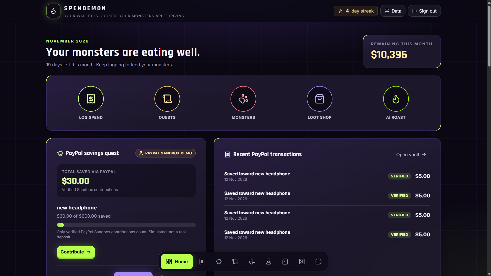
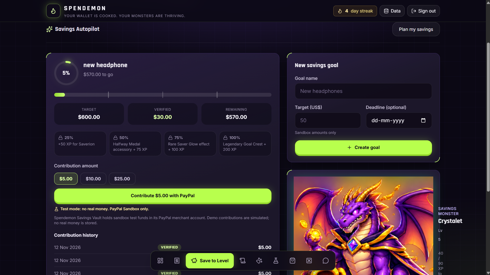
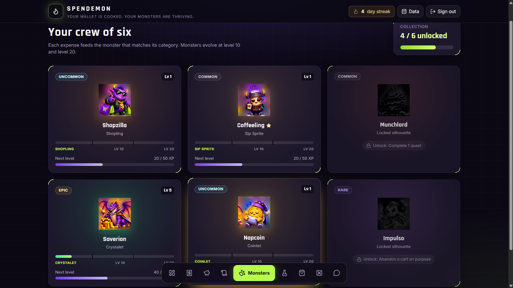
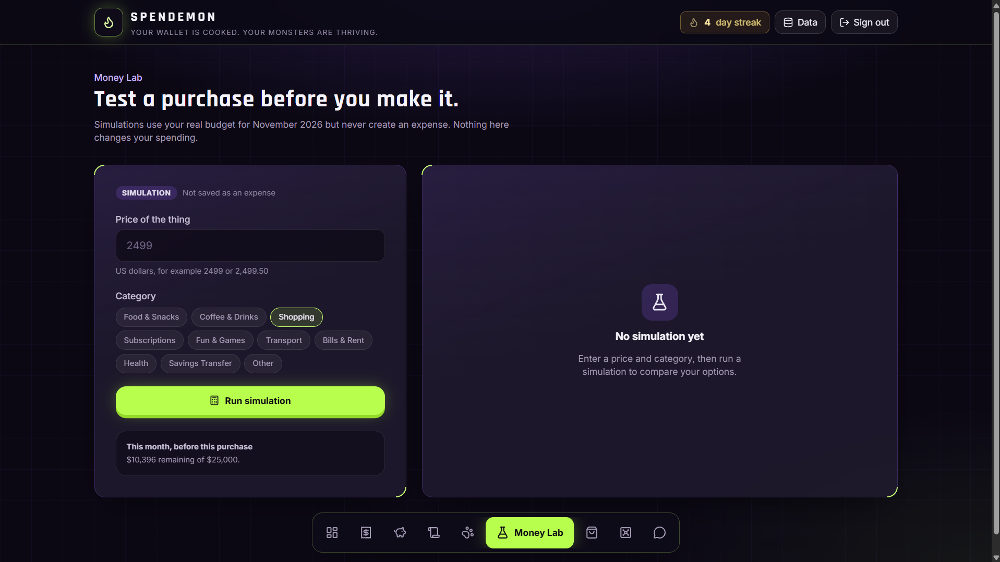
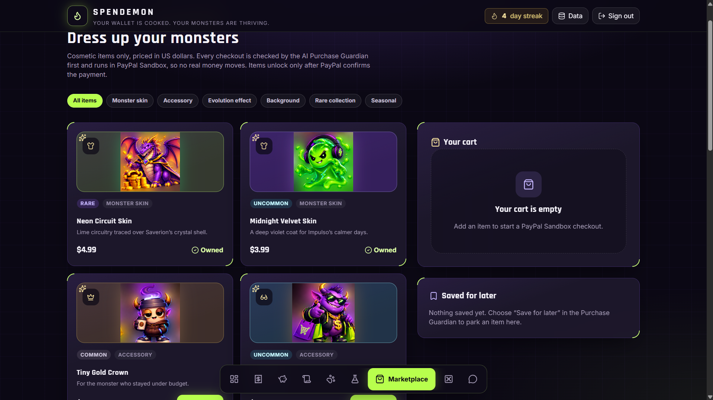
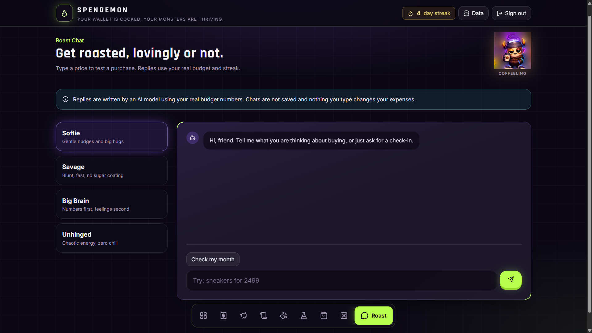

# Spendemon: Pay. Save. Evolve.

> Your wallet is cooked. Your monsters are thriving.

> **Live app:** https://REPLACE-WITH-YOUR-FINAL-URL · **Demo video:** https://REPLACE-WITH-YOUR-VIDEO-LINK
> **Judge access:** open the live app and press **Try as a judge**. No email or password needed.

Spendemon is a budgeting game. You log spending, stay under budget and your monsters level up. When you skip an impulse buy, you move that money into a savings goal with **PayPal**, and your saver monster grows with every verified payment.

---

## Table of contents

- [The problem](#the-problem)
- [The solution](#the-solution)
- [Screenshots](#screenshots)
- [Features](#features)
- [How PayPal is used](#how-paypal-is-used)
- [How AI is used](#how-ai-is-used)
- [Architecture in 5 lines](#architecture-in-5-lines)
- [Tech stack](#tech-stack)
- [For judges: 3-minute tour](#for-judges-3-minute-tour)
- [What is real and what is simulated](#what-is-real-and-what-is-simulated)
- [Security](#security)
- [Running it](#running-it)
- [Known limitations](#known-limitations)
- [What's next](#whats-next)
- [Team](#team)
- [License](#license)

---

## The problem

Budgeting apps tell you what you already spent. They rarely help you put money aside at the moment you decide not to spend it, and saving feels like a chore with no reward. Managing money feels like homework, while spending it feels rewarding.

## The solution

Spendemon turns financial discipline into a game. You log spending, stay under budget and your monsters level up. When you skip an impulse buy, you move that money into a savings goal with **PayPal**, and your saver monster, Saverion, grows with every verified payment. Hitting 25/50/75/100% of a goal unlocks rewards.

Your wallet isn't something you manage. It's an ecosystem you build.

## Screenshots

| Dashboard | Save to Level (PayPal) | Monsters |
|---|---|---|
|  |  |  |

| Money Lab | Marketplace + Purchase Guardian | Roast Chat |
|---|---|---|
|  |  |  |

> Add your screenshots to `docs/img/` using the file names above.

## Features

**Track**
- **Dashboard:** daily streak, Data menu to reset sample entries, five quick actions (Log Spend, Quests, Monsters, Loot Shop, AI Roast), PayPal savings quest, recent PayPal transactions, daily quests with XP
- **Spend page:** monthly budget, spent and remaining amounts, category filters, edit and delete entries, category breakdown with over-budget flags
- **AI Financial Insights:** your recorded facts first, then AI suggestions (weekly summary, budget tip, savings idea, quest idea), clearly labelled as guidance, not financial advice

**Save**
- **Save to Level:** savings goals with name, target and optional deadline; milestone rewards at 25, 50, 75 and 100%; contributions of $5, $10 or $25 through PayPal Sandbox; contribution history with verified, cancelled and awaiting-approval statuses
- **Savings Autopilot:** "Plan my savings" proposes how much to save today, with a reason and a risk level
- **Withdraw savings** for completed goals

**Play**
- **Quests:** daily quests with difficulty, rules, progress bars and XP paid to a specific monster
- **Achievements:** ten milestones such as First Receipt, Budget Keeper, On a Roll, Lab Rat, Evolution Watch, Cart Ghost and Full Collection
- **Monsters:** a crew of six across rarity tiers, fed by your spending categories, evolving at levels 10 and 20, with locked monsters that unlock through quests

**Decide**
- **Money Lab:** simulates a purchase without saving it as an expense, then offers: buy it now, wait 7 days, find a half-price version, set money aside daily, or skip it (skipping counts toward a quest)
- **Monster Marketplace:** monster skins, accessories, evolution effects, backgrounds, rare collections and seasonal items, with a cart, Owned tags and Save for later
- **AI Purchase Guardian:** checks the cart against your budget before PayPal checkout; continue, save for later or cancel
- **Roast Chat:** four AI personalities (Softie, Savage, Big Brain, Unhinged) that use your real budget numbers, plus a "Check my month" shortcut

**Prove**
- **Transaction Vault:** verified payments, verified total and saved-toward-goals, with search and filters by type, date and status, and a status timeline for each payment

**Judge mode**
- One-tap isolated test account with a guided spotlight tour

## How PayPal is used

- **Checkout (Orders v2):** goal contributions and Marketplace purchases create a PayPal order on the server. Prices come only from the server catalogue.
- **Verified capture:** after the player approves, the server captures the order and checks the amount, currency and owner before crediting anything. Credit is idempotent: a refresh, retry or double click never pays out twice.
- **Webhooks:** signed PayPal events are verified, de-duplicated and reconciled. Refunds and reversals undo the purchased items or the saved amount once, never below zero. Milestone rewards already earned are kept, and the refund shows in the Vault timeline.
- **Spendemon Savings Vault and withdrawals (Payouts):** contributions go to the Spendemon Savings Vault, a PayPal **Sandbox** merchant account that holds the saved money. A completed goal can be withdrawn with the PayPal Payouts API. Each goal can be paid out once only. If Payouts is not enabled on the sandbox account, the app records a clearly labelled **Simulated payout** instead.

## How AI is used

- **Savings Autopilot (Goals page):** "Plan my savings" reads your budget, recent spending and goal deadlines, and the AI proposes how much to save today, with a reason, a risk level and a lower alternative. The server checks the proposal: the goal must be yours, the amount must be a whole number of cents and must fit the goal's remaining target and your remaining monthly budget. If the AI answer is invalid or unavailable, a calculated plan is used and labelled **Calculated fallback**. **The AI never pays.** You confirm every payment yourself.
- **Purchase Guardian (Marketplace):** before checkout, facts calculated on the server (budget left, days of spending) plus advice labelled **AI explanation** or **Calculated fallback**. The pay button never waits for the AI.
- **Insights and Roast chat:** one shared AI path (Gemini key if set, otherwise the built-in Lovable AI). Replies use your real budget numbers, chats are not saved, and nothing you type changes your expenses.

## Architecture in 5 lines

1. TanStack Start (React 19) app with server functions; Tailwind CSS v4 for styling.
2. Lovable Cloud database and auth; each player's game state is one row, saved with a version check.
3. All payment and AI work runs in server functions that require a signed-in player; secrets never reach the browser.
4. PayPal calls go through the Lovable connector gateway; webhooks land on `/api/public/paypal-webhook` and are signature-checked.
5. Credits, refunds and payouts are database functions that only the server can call, so they are atomic and run once.

## Tech stack

TanStack Start (React 19) · Tailwind CSS v4 · Lovable Cloud (database and auth) · PayPal Orders v2, Webhooks and Payouts (Sandbox) · Gemini / Lovable AI · Drizzle · Vitest · Bun · Hosted on REPLACE-WITH-VERCEL-OR-LOVABLE

## For judges: 3-minute tour

1. On the sign-in screen press **Try as a judge**. This creates a fresh, isolated test account (no email needed) with the demo journey already started. Nothing you do touches any other player.
2. A **spotlight tour** highlights the real buttons on each page. Skip it at any time.
3. **Dashboard:** "Total saved via PayPal" counts verified payments only. Demo money is shown separately. **Reset demo** clears demo rows.
4. **Goals:** press **Plan my savings**, review the plan, then **Confirm simulated payment**. The money is recorded in the Vault and the goal ring fills. Completed goals sit under **Completed goals**, with **Withdraw savings**.
5. **Marketplace:** pick an item to open the **Purchase Guardian**.
6. **Vault:** filter by type, status and date, then tap a row to see its status timeline.
7. **`/judges`:** the PayPal self-test. Green or red for checkout keys, webhook ID and AI, plus the exact name of any missing secret.

> Judge accounts use simulated checkout, so payments there are never counted as verified. To see real PayPal Sandbox verification, sign in with your own account.

Full walkthrough: [docs/DEMO_SCRIPT.md](docs/DEMO_SCRIPT.md).

## What is real and what is simulated

| Area | Status |
|---|---|
| Accounts, game saves, goals, orders | Real, stored in Lovable Cloud with per-player access rules |
| PayPal checkout and capture | **PayPal Sandbox only.** No real money. The server verifies every capture before crediting |
| Judge accounts and demo goals | **Simulated checkout:** same screens, labelled "Simulated", PayPal is never called, never counted as verified |
| Refunds and reversals | Real webhook handling. Value is reversed once; milestone rewards are kept |
| Spendemon Savings Vault | A PayPal Sandbox merchant account holding test money, **not a bank deposit** |
| Withdraw savings | PayPal Sandbox Payouts when enabled; otherwise a labelled **Simulated payout**. Always simulated for demo goals |
| AI (Autopilot, Guardian, insights, roast) | Live AI with server checks; a labelled **Calculated fallback** when AI is unavailable |

All amounts are shown in **USD**.

## Security

- Secrets live only in server-side environment variables. `.env` is not committed; see `.env.example` for the names.
- Prices come only from the server catalogue; the browser never decides rewards or credits.
- PayPal captures are verified (amount, currency, owner) and idempotent. Webhooks are signature-checked and de-duplicated.
- The AI never moves money. Every payment is confirmed by the player.
- Credits, refunds and payouts run in server-only database functions.

## Running it

```
bun install
bun run dev      # local dev server
bun run test     # unit tests (vitest)
bun run lint
bun run build
```

Copy `.env.example` to `.env` and fill in the values locally. Never commit `.env`.

Server-side settings (names only, see `.env.example`):

| Name | Needed for |
|---|---|
| `PAYPAL_CLIENT_ID` | PayPal Sandbox checkout |
| `PAYPAL_API_KEY`, `LOVABLE_API_KEY` | PayPal Sandbox calls through the connector gateway (set by connecting PayPal) |
| `PAYPAL_WEBHOOK_ID` | Verifying PayPal webhooks |
| `GEMINI_API_KEY` | Optional; the built-in Lovable AI is used without it |
| `SPENDEMON_OWNER_USER_ID` | Only this account sees the "Sandbox setup needed" notice |

Health check: `GET /api/public/paypal-health` returns true/false readiness flags only, never secret values.

## Known limitations

- PayPal runs in **Sandbox** only; no real money moves.
- Judge accounts use simulated checkout, which is never counted as verified.
- AI features fall back to a labelled calculated plan when the AI is unavailable.

## What's next

See [roadmap.md](roadmap.md).

## Team

REPLACE-WITH-YOUR-NAME · [@MO564ANKIT](https://github.com/MO564ANKIT)

## License

MIT. See the `LICENSE` file. *(Add a `LICENSE` file to the repo, or change this line to your license.)*
